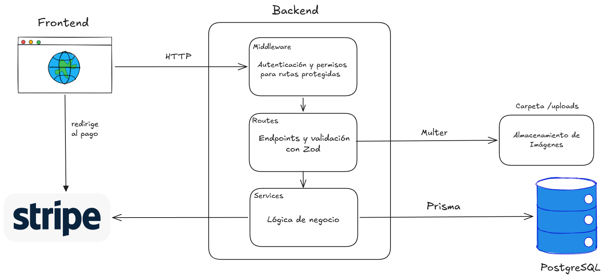

# PLATAFORMA DE ECOMMERCE 

## Descripción

Una aplicación de ecommerce, enfocada en libros. Los usuarios pueden recorrer el catálogo, agregar productos al carrito, modificarlo, realizar una compra y revisar sus órdenes. Para las compras se integra con Stripe en modo prueba. 

## Stack

- Frontend: React + Vite, con TypeScript, React Router y TanStack Query.
- Backend: TypeScript + Express.
- Estilos del Frontend: shadcn/ui + Tailwind.
- Base de datos: PostgreSQL con Prisma como ORM. Docker para levantar el servicio de PostgreSQL.
- Extras: Zod para validación de datos, JWT + bcryptjs para autenticación.

## Requisitos 

- Node.js,  versión 24.
- Docker.
- Cuenta de Stripe en modo prueba.

## Cómo levantar la aplicación

Es necesario primero crear las variables de entorno. Para esto, copiar tanto dentro de /backend como /frontend el `.env.example` a un archivo `.env`. La única que es necesario rellenar es `STRIPE_SECRET_KEY`.
Se obtiene en https://dashboard.stripe.com/apikeys y debe empezar con `sk_test_`.

Luego, los comandos son:

```bash
docker compose up -d
```

En /backend:

```bash
npm install
npx prisma migrate deploy
npx prisma db seed
npm run dev
```

En /frontend, desde otra terminal:

```bash
npm install
npm run dev
```

Y la aplicación se levanta en http://localhost:5173/

## Cómo probarlo

Se crea un administrador a partir de una seed para la base de datos junto con algunos productos.
La cuenta de este administrador es:
- email: admin@tienda.com
- contraseña: admin1234

Para probar un pago se puede utilizar la tarjeta con número 4242 4242 4242 4242, el CVC puede ser cualquiera y la fecha es cualquier fecha futura.

## Decisiones de diseño

1. Una orden se inicializa con estado **PENDING** cuando inicia el checkout y pasa a **PAID** cuando el pago es confirmado. De esta manera se congelan los precios que va a cobrar Stripe. Solo las órdenes en estado **PAID** cuentan como compra.
2. El frontend no envía precios, los subtotales y totales se calculan dentro del backend. 
3. Un OrderItem guarda el precio y nombre del producto en el momento de la compra, por lo que sirven como comprobante y no cambian si el administrador los edita.
4. Los productos no se eliminan, un administrador puede desactivarlos. Se muestran como inactivos si existían en algún carrito y no se cobran.
5. Las imágenes de los productos se almacenan en el disco local, en la base de datos se almacena su nombre. Se aceptan únicamente imágenes con formato JPEG, PNG o WebP, de hasta 2 MB.

### Estructura a alto nivel



## Lista de endpoints

### Autenticación

| Método | Ruta | Acceso | Descripción |
|---|---|---|---|
| POST | `/auth/register` | Público | Crea un usuario `CUSTOMER` y devuelve `{ token, user }`. |
| POST | `/auth/login` | Público | Inicia sesión y devuelve `{ token, user }`. |
| GET | `/auth/me` | Con sesión | Devuelve el usuario del token. |

### Productos

| Método | Ruta | Acceso | Descripción |
|---|---|---|---|
| GET | `/products` | Público | Lista los productos activos. Acepta `?search=` para filtrar por nombre. |
| GET | `/products/:id` | Público | Detalle de un producto activo. |

### Administrador

| Método | Ruta | Acceso | Descripción |
|---|---|---|---|
| GET | `/admin/products` | Admin | Lista todos los productos, activos e inactivos. |
| GET | `/admin/products/:id` | Admin | Detalle de un producto. |
| POST | `/admin/products` | Admin | Crea un producto. |
| PATCH | `/admin/products/:id` | Admin | Edita un producto, incluido activarlo o desactivarlo. |
| POST | `/admin/products/:id/image` | Admin | Sube la imagen del producto (`multipart/form-data`, campo `image`). |

### Carrito

| Método | Ruta | Acceso | Descripción |
|---|---|---|---|
| GET | `/cart` | Con sesión | Devuelve el carrito: `{ items, total }`. |
| POST | `/cart/items` | Con sesión | Agrega un producto (`{ productId, quantity }`). Si ya está, suma la cantidad. |
| PATCH | `/cart/items/:productId` | Con sesión | Cambia la cantidad de un producto. |
| DELETE | `/cart/items/:productId` | Con sesión | Quita un producto del carrito. |

### Checkout

| Método | Ruta | Acceso | Descripción |
|---|---|---|---|
| POST | `/checkout` | Con sesión | Crea la orden `PENDING` y la sesión de Stripe. Devuelve `{ url }` de la página de pago. |
| POST | `/checkout/confirm` | Con sesión | Verifica el pago con Stripe (`{ sessionId }`) y marca la orden como `PAID`. |

### Órdenes

| Método | Ruta | Acceso | Descripción |
|---|---|---|---|
| GET | `/orders` | Con sesión | Lista las órdenes del usuario, de la más nueva a la más vieja. |
| GET | `/orders/:id` | Con sesión | Detalle de una orden propia. |
| POST | `/orders/:id/cancel` | Con sesión | Cancela una orden `PENDING`. |


